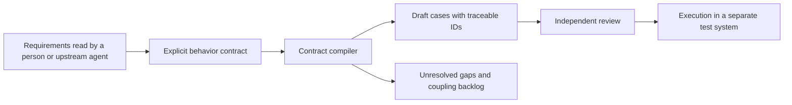

# Evidence Test Workbench

**Design traceable test cases with an agent skill, then optionally compile explicit contracts into reviewable drafts.**

[中文说明](README.zh-CN.md) · [Example output](docs/example-output.md) · [Design](docs/design.md) · [Publication status](docs/publication.md)

Requirements often leave questions unanswered. This tool keeps those gaps visible while expanding the behavior that is actually specified into test cases with stable IDs and traceable claims.

This repository contains a [generic case-design skill](skills/evidence-case-design/SKILL.md) and a small offline compiler extracted from a larger requirements-to-testing workbench. It uses Python's standard library, synthetic examples, and no accounts or hardware. The Python compiler does **not** interpret natural-language requirements or call an LLM; a person or an agent following the skill authors the structured contract.

## Use the case-design skill

Copy `skills/evidence-case-design/` into your coding agent's supported skill directory. Supply requirements and the desired scope. The skill guides evidence gathering, boundary and state analysis, observable expectations and unresolved questions. It can produce Markdown drafts without the compiler; it does not include an AI model or a hosted service.

To export the portable skill, including its synthetic example and license:

```sh
python tools/package_skill.py --output dist/evidence-case-design.zip
```

Use a new archive path for each export. General AI-generated case quality still requires independent evaluation against your requirements.

## Try the offline compiler

Python 3.10 or newer, from the repository directory:

```sh
python -m evidence_test_workbench demo --output demo-output
python -m unittest discover -s tests -v
```

Open `demo-output/cases.md` to inspect the draft cases and `demo-output/summary.json` for the compilation summary. All cases remain **unexecuted**, and independent review remains pending.

The synthetic task-list example includes filter variants and an archive action. Its external-sync behavior is deliberately unspecified: the compiler should expose a gap, not invent a synchronization rule.

To compile your own explicit contract:

```sh
python -m evidence_test_workbench compile demo-output/contract.json --output build/my-cases --phase core
```

Use a new output directory for each run. A successful compile means artifacts were produced; it does not mean the product passed testing or the requirements are complete.

## What to inspect

- **Traceability:** generated cases carry source-claim and coverage-obligation IDs.
- **Stable identity:** changing a title or reordering explicit variants should not create new logical case IDs.
- **Explicit expectations:** missing or unconfirmed expectations stay visible as gaps.
- **Core and coupling:** unresolved dependent behavior stays in a backlog; mandatory core prerequisites cannot be silently deferred.
- **Native Python core:** the compiler can be embedded in another service without a hosted AI runtime.



The generic skill, compiler and local artifact export are included here. The full source project's source ingestion, approval lifecycle, requirement-change tracking, spreadsheet export, Jira integration, web console, and vehicle execution are outside this extracted package.

## Development

The test suite uses synthetic inputs and runs offline. GitHub Actions configuration is included; a local passing run is not a claim that hosted CI has already run.

The extraction and any modifications are recorded in the source provenance manifest. Original project code is distributed under the [MIT License](LICENSE), following the author's ownership confirmation. See [publication scope](docs/publication.md).
